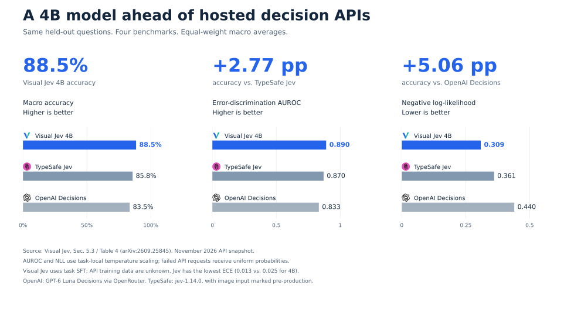
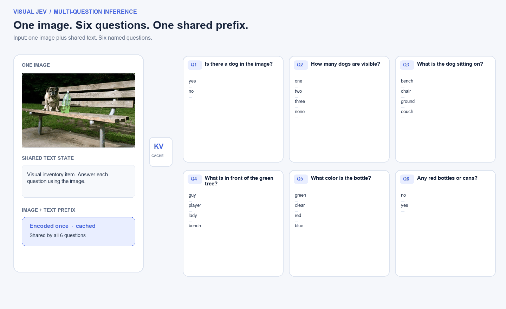
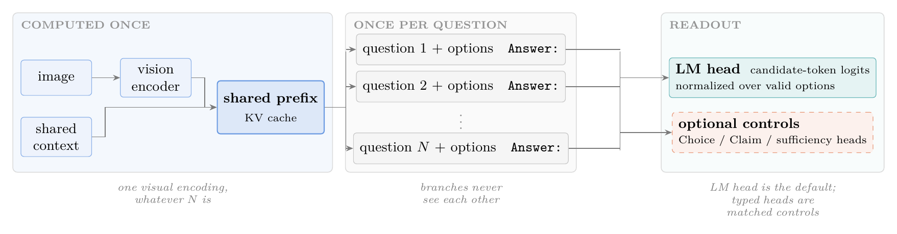
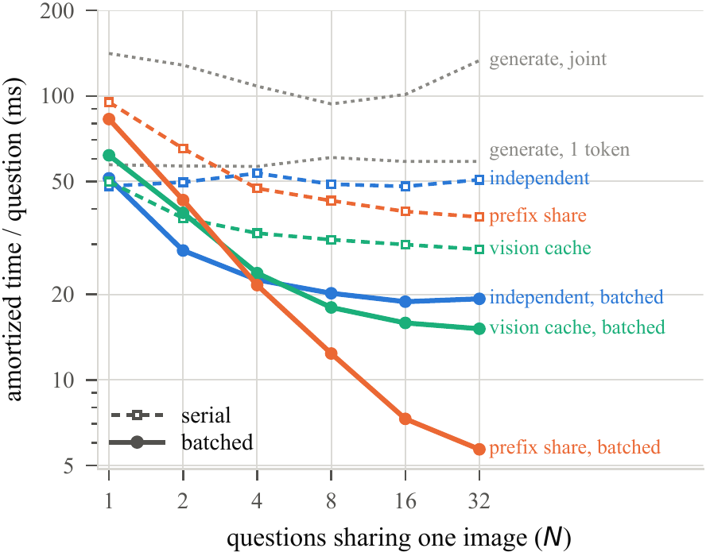
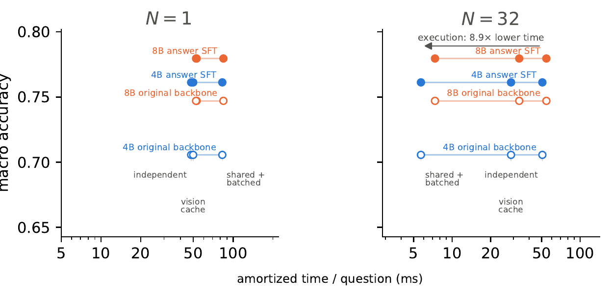

<p align="center">
  
</p>

<h1 align="center">Visual Jev</h1>

<p align="center">
  <strong>Accurate and Efficient Decisions from Shared Visual Context</strong><br>
  <sub>Guanxu Yu · Yuhang Yao</sub>
</p>

<p align="center">
  <a href="https://guanxuyu-sv.github.io/Visual-Jev/"><b>🌐 Website</b></a> &nbsp;·&nbsp;
  <a href="https://arxiv.org/abs/2609.25845"><b>📄 Paper</b></a> &nbsp;·&nbsp;
  <a href="https://huggingface.co/guanxuyu/visual-jev-4b-answer-sft"><b>🤗 visual-jev-4b</b></a> &nbsp;·&nbsp;
  <a href="https://huggingface.co/guanxuyu/visual-jev-8b-answer-sft"><b>🤗 visual-jev-8b</b></a>
</p>

<p align="center"><b>One image. Independent questions. Shared compute.</b></p>

Visual Jev extends the Jev decision interface to vision: encode an image and shared context once, run independent question branches together, and return probabilities over the choices in each request. The recommended system is **answer-supervised Qwen3-VL-4B LoRA with the existing LM head**.

## Small model. Strong decisions.

**88.5% macro accuracy** · **+2.77 pp vs. TypeSafe Jev** · **+5.06 pp vs. OpenAI Decisions**

[](https://guanxuyu-sv.github.io/Visual-Jev/#apis)

<sub><a href="https://arxiv.org/abs/2609.25845">Paper, Table 4</a> · <a href="https://guanxuyu-sv.github.io/Visual-Jev/#apis">Full results &amp; protocol</a>. Four benchmarks, November 2026. Visual Jev uses task SFT; API training data are unknown. Jev leads on ECE and TextVQA.</sub>

## One image, six questions

<p align="center">
  <a href="https://guanxuyu-sv.github.io/Visual-Jev/#demo"></a>
</p>

<p align="center"><sub>One visual encoding, six independent probability distributions. <a href="https://guanxuyu-sv.github.io/Visual-Jev/#demo">Explore real model outputs ↗</a></sub></p>

## Try the released model

**CUDA or Apple Silicon MPS · Inference only · No training dataset required**

From the repository root, create an environment and install dependencies. On a Mac, use a regular macOS PyTorch build, as below; the CUDA wheel command in the reproduction guide is for NVIDIA systems.

```bash
python3 -m venv .venv && source .venv/bin/activate
pip install torch torchvision
pip install -r code/requirements.txt
```

Run the included image and six-question request:

```bash
python code/examples/quickstart.py \
    --image assets/figures/demo_bottle.jpg \
    --request-file code/examples/bottle_questions.json --device auto
```

The runner downloads the 4B backbone and adapter on first use, caches the image and shared `state`, and returns choices and probabilities. `--device auto` selects CUDA first, then Apple MPS. It supports `choice` questions with **2–16 options**; the demo includes `incorrect_question` for false premises.

<details>
<summary><b>Use your own image or the 8B adapter</b></summary>

Classify your own image among choices you supply:

```bash
python code/examples/quickstart.py --image /path/to/image.jpg \
    --question "What animal is in the image?" \
    --choices cat dog bird other --device auto
```

For multiple questions, use the named `questions` and shared `state` format in [`bottle_questions.json`](code/examples/bottle_questions.json). The included example covers presence, count, objects, spatial relations, and color; it catches the dog/person mismatch with 0.966 probability.

To use **visual-jev-8b**, append:

```bash
--model Qwen/Qwen3-VL-8B-Instruct \
--adapter guanxuyu/visual-jev-8b-answer-sft
```

The 8B adapter needs about twice the memory. It reaches **89.3%** macro accuracy in the API comparison, and **0.780 vs. 0.761** for 4B in the separate ablation evaluation below. These evaluations use different TallyQA subsets and their macro averages are not interchangeable.

</details>

<details>
<summary><b>Calibrate probabilities before making accept-or-review decisions</b></summary>

The raw probabilities are overconfident, so do not threshold them directly. Collect the option logits on a few hundred labelled questions from your own task (`--save-logits calib.jsonl`, then add a `"label"` with the index of the correct option to each line), and fit a temperature and a risk threshold on them:

```bash
python code/examples/calibrate.py fit   --scores calib.jsonl --risk 0.05 0.1 --out calibration.json
python code/examples/calibrate.py apply --scores new.jsonl --calibration calibration.json --risk 0.05
```

`apply` accepts the answers whose calibrated top probability clears the threshold and marks the rest for review. Fit on data from the task you deploy on: a temperature carried over from another task calibrates clearly worse. The thresholds are empirical, not guarantees; in our measurements they held their targets on held-out questions given several hundred calibration questions, and missed them with 160. Keep the option order fixed between fitting and deployment, because reordering the same options changes some accept-or-review decisions. The 8B model card lists the temperatures we fitted per benchmark (`temperatures.json`).

</details>

## Research at a glance

| Finding | Evidence from the paper |
| --- | --- |
| **Use the existing LM head.** | Answer SFT and a matched typed linear decision head both reach **0.761** four-benchmark macro accuracy. The head has no consistent advantage across three seeds. |
| **Fine-tune for the target task.** | The 4B backbone rises from **0.706 → 0.761** macro accuracy after answer supervision. Most of the gain is on GQA and SNLI-VE, the task families represented in training; held-out TextVQA and TallyQA change little. |
| **Share work across questions.** | With **32 questions per image**, shared-prefix batching reaches **5.7 ms amortized per question**, versus **50.7 ms** for independent serial execution and **19.3 ms** for batching without prefix reuse. |

<sub>The table above uses the paper’s ablation evaluation, with a shorter TallyQA subset than the hosted-API comparison. Timing: RTX 5090, bfloat16, 32 questions sharing one image.</sub>

<details>
<summary><b>Architecture · shared context, isolated decisions</b></summary>



The image and shared text form a cached prefix. Each branch reads only its own question and candidates; branches cannot see one another’s answers. Candidate-token logits at each `Answer:` position are normalized over the valid choices. The typed heads in the diagram are experimental controls.

[Architecture walkthrough on the website ↗](https://guanxuyu-sv.github.io/Visual-Jev/#method)

</details>

<details>
<summary><b>Efficiency · what the 8.9× throughput gain means</b></summary>

The **8.9×** comparison is a throughput result: the shared batch of 32 finishes in about **182 ms**. Its 5.7 ms figure is the batch time divided by 32, not the latency of one independently arriving request. At `N = 1`, prefix sharing adds overhead (**82.9 ms** versus **48.1 ms** independent). At `N = 32`, peak allocated memory rises from **8.40 to 10.10 GiB**. The speedup comes from both parallel question execution and reuse of visual context.

This is also how we interpret Jev's speed: parallel decisions over shared context can improve throughput, while batching one question does not make the same model's single request faster. A smaller backbone can lower absolute inference cost. In our matched 32-question shared-batch measurement, **4B takes 5.7 ms/question** and **8B takes 7.3 ms/question**, with macro accuracy of **0.761** and **0.780**, respectively. This model-size comparison is separate from the execution-path gain; we did not measure the latency of another Jev service.

### Execution sweep



Warm amortized time per question as more questions share an image. Color identifies the reused computation; solid lines are batched paths and dashed lines are serial paths.

### Accuracy and execution cost



At `N = 1`, prefix sharing adds overhead. At `N = 32`, it moves each backbone left on the cost axis without changing its training state. Hollow and filled markers separate the original backbone from answer SFT; blue and orange separate 4B and 8B.

Timings are synchronized warm measurements on one RTX 5090 in bfloat16. They start from an in-memory decoded image and include preprocessing, transfer, and execution. Image decoding, disk and network I/O, and serving queues are excluded. See the [paper](https://arxiv.org/abs/2609.25845) for the full protocol and limitations.

</details>

[Interactive latency explorer](https://guanxuyu-sv.github.io/Visual-Jev/#explorer) · [Controls, limitations & negative results](https://guanxuyu-sv.github.io/Visual-Jev/#research)

## Corrections & evaluation notes

The first paper version has image-resolution and TallyQA-overlap corrections; the risk-threshold implementation was also corrected. The headline results above are unaffected.

<details>
<summary><b>Read the corrections and their measured impact</b></summary>

Two statements in the paper's first version are wrong; the results above are unaffected.

- **Image resolution.** The paper states a budget of 196 visual tokens (`max_pixels = 200,704`). The code sets that through an image-processor attribute which the Transformers release we used ignores, so every training, evaluation and timing run used the processor's default, which keeps native resolution: a 500×500 GQA image becomes 256 visual tokens. All execution paths still agree with each other. The quickstart's `--max-pixels` has no effect for the same reason.
- **TallyQA is not entirely unseen.** Comparing image content, 46 of the 498 TallyQA images (9.2%) are copies of GQA training images. Accuracy on them is not higher (0.341 against 0.366 on the others for the 4B adapter), so the overlap does not inflate the held-out results, but those images are not unseen.

The risk-threshold code also had a bug, now fixed: when several questions tied at the threshold confidence, it could pick a cut inside the tie, and the resulting threshold then admitted the whole tied group, exceeding the target on the calibration data. Thresholds now fall only between distinct confidence values (`code/tests/test_threshold.py`). Ties are rare in the adapters' continuous probabilities: re-running the 4B and 8B threshold analysis with the fix moved 4 of 48 thresholds, changing coverage by at most 0.4 points and realized risk by at most 0.001. Rounded or discretized probabilities tie far more often and are affected much more.

</details>

## Reproduce the paper

Follow [REPRODUCE.md](REPRODUCE.md) for datasets, training, evaluation, and the exact environment. The scored outputs in [`data/`](data/) can be inspected without a GPU.

<details>
<summary><b>Workflow, repository layout & scope</b></summary>

Follow the [end-to-end reproduction guide](REPRODUCE.md) for the exact environment, dataset layout, commands, and evaluation settings. The workflow is:

1. Obtain the source datasets and build the question records for GQA, SNLI-VE, TextVQA, and TallyQA.
2. Train the answer-supervised LoRA system and the matched head controls. The published [4B adapter](https://huggingface.co/guanxuyu/visual-jev-4b-answer-sft) contains the recommended system's LoRA weights.
3. Run predictions on the four evaluation sets, score them, and regenerate the paper's tables and figures with `code/reports/`.

The scored outputs in `data/` let you inspect the reported numbers without a GPU. Reproducing the predictions requires the source datasets, backbone weights, and a GPU.

```text
code/vdm/               data building, training, and evaluation
code/examples/          minimal inference example
code/reports/           tables and figure generation
data/                   scored experimental outputs
site/                   website source and build scripts
docs/index.html         generated GitHub Pages site
assets/figures/         README figures and the bottle demo image
REPRODUCE.md           end-to-end reproduction guide
```

The paper covers one backbone family at two sizes, four forced-choice benchmark conversions, and a single-machine timing setup. Its scope and statistical limitations are described in the [manuscript](https://arxiv.org/abs/2609.25845).

</details>

## Citation

```bibtex
@misc{yu2026visualjev,
  title        = {Visual Jev: Accurate and Efficient Decisions from Shared Visual Context},
  author       = {Guanxu Yu and Yuhang Yao},
  year         = {2026},
  eprint       = {2609.25845},
  archivePrefix = {arXiv},
  primaryClass = {cs.CV},
  url          = {https://arxiv.org/abs/2609.25845}
}
```

## License

The repository's code and documentation are released under [Apache-2.0](LICENSE). The [LoRA adapter](https://huggingface.co/guanxuyu/visual-jev-4b-answer-sft) is also listed as Apache-2.0 on its model card. The Qwen backbone, source datasets, and paper are distributed under their respective upstream terms.

<details>
<summary><b>Website development</b></summary>

The [project website](https://guanxuyu-sv.github.io/Visual-Jev/) presents examples, a latency explorer, and negative results. Its figures are generated from the scored outputs in `data/`. Regenerate the API comparison figure after changing its source data, then rebuild the page:

```bash
uv run --with matplotlib python site/make_api_comparison.py
python3 site/build_site.py --reports data --demos data/demos.json
```

`docs/index.html` is generated output; edit `site/template.html` to change the website. `site/make_demos.py` builds `data/demos.json` from raw per-example predictions and model input images, which are not stored in this repository.

</details>
